# SecLearn — Tài liệu thiết kế chi tiết (Detail Design)

> Ngày lập: 2026-10-18. Nhánh: `fix/chat-context`.
> Nguồn: dựng lại từ mã nguồn trong repo (`prisma/schema.prisma`, `prisma/migrations/`, `src/app/api/**`, `src/app/[locale]/**`,
> `src/lib/**`, `src/components/**`, `scripts/embed_server.py`). Repo không có file thiết kế (ERD, sequence, API spec, mockup) dựng sẵn,
> nên mọi sơ đồ dưới đây được vẽ theo code hiện tại. Chỗ nào code và README khác nhau, tài liệu theo code.
>
> Sơ đồ viết bằng **Mermaid** (xem được trên GitHub, VS Code + Markdown Preview Mermaid, hoặc https://mermaid.live).

---

## Mục lục

1. [Tổng quan hệ thống](#1-tổng-quan-hệ-thống)
2. [Chức năng chính](#2-chức-năng-chính)
3. [Kiến trúc hệ thống](#3-kiến-trúc-hệ-thống)
4. [Thiết kế cơ sở dữ liệu](#4-thiết-kế-cơ-sở-dữ-liệu)
5. [Thiết kế sơ đồ tuần tự (Sequence diagram)](#5-thiết-kế-sơ-đồ-tuần-tự-sequence-diagram)
6. [Thiết kế API](#6-thiết-kế-api)
7. [Thiết kế màn hình (Screen Design)](#7-thiết-kế-màn-hình-screen-design)
8. [Phụ lục: cấu hình môi trường](#8-phụ-lục-cấu-hình-môi-trường)

---

## 1. Tổng quan hệ thống

**SecLearn** là ứng dụng web học an toàn thông tin cơ bản cho người mới, song ngữ Việt/Anh, gồm:

- **Trợ lý ảo AI (chatbot RAG)**: trả lời câu hỏi bảo mật *chỉ dựa trên tài liệu PDF* do quản trị viên tải lên, có trích dẫn `[n]`,
  panel nguồn, hậu kiểm trích dẫn bằng cross-encoder và chấm điểm độ liên quan bằng LLM (LLM-as-judge).
- **Bài học** song ngữ (VI/EN).
- **Ôn tập**: sinh bộ câu hỏi trắc nghiệm bằng LLM, làm bài, chấm điểm, lưu lịch sử.
- **Quản trị**: quản lý người dùng, tài liệu PDF (ingest → chunk → embedding → pgvector), bài học.

| Thành phần | Công nghệ |
|---|---|
| Frontend + Backend | Next.js 16 (App Router, monolith), React 19, TypeScript |
| Giao diện | Tailwind CSS 4, component kiểu shadcn (Radix UI), lucide-react, sonner (toast) |
| Đa ngôn ngữ | next-intl, route `/{locale}/...` với `locale ∈ {vi, en}`, mặc định `vi` |
| Xác thực | Auth.js (next-auth v5), Credentials provider, phiên JWT, mật khẩu bcrypt |
| CSDL | PostgreSQL 16 + extension **pgvector**, ORM Prisma 6 |
| LLM | DeepSeek (`deepseek-flash`) / OpenAI (`gpt-4o-mini`) / `mock` qua SDK `openai` |
| Embedding | `huggingface` (BKAI `vietnamese-bi-encoder`, 768 chiều, chạy cục bộ qua `scripts/embed_server.py`) / `openai` / `local` (MiniLM) / `mock` |
| Rerank | Cross-encoder `BAAI/bge-reranker-v2-m3` qua endpoint `/rerank` của `embed_server.py` |
| PDF | `pdf-parse` |
| Triển khai | Docker Compose (app + Postgres pgvector), cổng 3847 |

---

## 2. Chức năng chính

### 2.1 Tác nhân (actor) và phân quyền

Toàn bộ chính sách phân quyền nằm ở `src/lib/permissions.ts`:

| Quyền (Action) | Khách (guest) | Người học (learner) | Quản trị (admin) |
|---|:-:|:-:|:-:|
| `lesson:read` — xem bài học | ✔ | ✔ | ✔ |
| `chat:ask` — hỏi chatbot | ✔ (giới hạn 10 câu) | ✔ | ✔ |
| `chat:history` — lưu / xem lịch sử hội thoại | | ✔ | ✔ |
| `quiz:generate` — tạo & làm bộ ôn tập | | ✔ | ✔ |
| `admin:access`, `lesson:manage`, `document:manage`, `user:manage` | | | ✔ |
| Tài liệu RAG được dùng để trả lời | `public` | `public`, `authenticated` | `public`, `authenticated` |

Quy tắc bổ sung:
- Quiz chỉ người tạo mở được, trừ khi `published = true` (`canAccessQuiz`).
- Admin không được tự khóa / tự đổi vai trò của mình, và không được làm hệ thống mất admin hoạt động cuối cùng (`userPatchError`,
  chạy trong transaction `Serializable`).
- Tài khoản bị khóa (`disabledAt ≠ null`) bị từ chối ở mọi API; JWT kiểm tra lại vai trò/trạng thái mỗi 5 phút.

### 2.2 Danh sách chức năng

| Mã | Nhóm | Chức năng | Tác nhân |
|---|---|---|---|
| F01 | Xác thực | Đăng ký tài khoản (kiểm tra độ mạnh mật khẩu: ≥ 8 ký tự, hoa, thường, số, ký tự đặc biệt) | Khách |
| F02 | Xác thực | Đăng nhập / đăng xuất (email + mật khẩu) | Khách / Người dùng |
| F03 | Xác thực | Lấy thông tin người dùng hiện tại | Người dùng |
| F04 | Chatbot | Chat khách: hỏi tối đa `GUEST_QUESTION_LIMIT` (10) câu, lịch sử lưu ở `localStorage` | Khách |
| F05 | Chatbot | Xem số câu hỏi khách còn lại | Khách |
| F06 | Chatbot | Tạo / liệt kê / mở / xóa hội thoại | Người dùng |
| F07 | Chatbot | Gửi câu hỏi, nhận câu trả lời streaming (SSE) có trích dẫn | Người dùng |
| F08 | Chatbot | Chuyển hội thoại khách (localStorage) vào tài khoản sau khi đăng nhập | Người dùng |
| F09 | Chatbot | Panel nguồn: đoạn được/không được trích, điểm rerank, hậu kiểm trích dẫn, đánh giá LLM | Mọi người |
| F10 | RAG | Lập kế hoạch truy vấn (viết lại câu hỏi, dịch sang tiếng Anh, HyDE, câu hỏi so sánh, nhận diện câu hỏi về chính hội thoại) | Hệ thống |
| F11 | RAG | Truy xuất lai: vector (pgvector cosine) + từ khóa (tsvector) + rerank cross-encoder + ngưỡng liên quan | Hệ thống |
| F12 | RAG | Từ chối cố định khi không có tài liệu liên quan (không gọi LLM) | Hệ thống |
| F13 | Bài học | Danh sách bài học đã xuất bản, xem chi tiết theo ngôn ngữ (fallback `vi`) | Mọi người |
| F14 | Ôn tập | Sinh bộ câu hỏi trắc nghiệm bằng LLM (tùy chọn dựa trên hội thoại) | Người dùng |
| F15 | Ôn tập | Làm bài, nộp, chấm điểm (%), xem lịch sử làm bài | Người dùng |
| F16 | Quản trị | Quản lý người dùng: xem danh sách, đổi vai trò, khóa / mở khóa | Admin |
| F17 | Quản trị | Quản lý tài liệu: tải nhiều PDF, đặt hiển thị, xem file, reindex, xóa; theo dõi trạng thái ingest | Admin |
| F18 | Quản trị | Ingest nền: hàng đợi trong tiến trình, trích PDF → làm sạch → Markdown → chunk → embedding → lưu | Hệ thống |
| F19 | Quản trị | Quản lý bài học song ngữ: tạo / sửa / xóa / xuất bản | Admin |
| F20 | Chung | Đổi ngôn ngữ VI/EN, đổi giao diện sáng/tối | Mọi người |

### 2.3 Sơ đồ use case

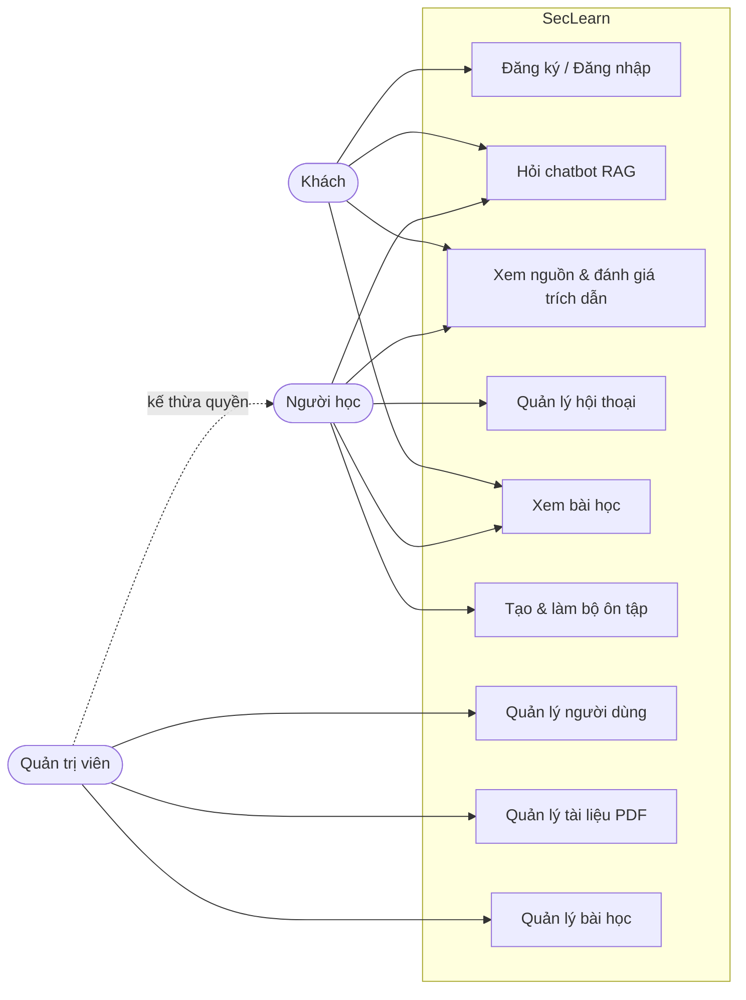

---

## 3. Kiến trúc hệ thống

### 3.1 Sơ đồ thành phần

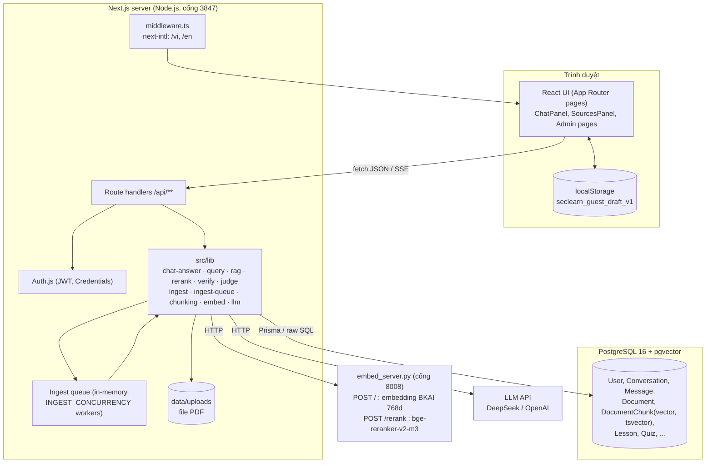

### 3.2 Cấu trúc thư mục chính

| Đường dẫn | Vai trò |
|---|---|
| `src/app/[locale]/` | Các trang giao diện (chat, lessons, on-tap, login, register, admin/*) |
| `src/app/api/` | REST API + SSE |
| `src/lib/permissions.ts` | Bảng phân quyền |
| `src/lib/session.ts` | `requireUser`, `requireAdmin`, định dạng lỗi JSON |
| `src/lib/chat-answer.ts` | Điều phối trả lời: lịch sử → kế hoạch tìm kiếm → truy xuất → gọi LLM |
| `src/lib/query.ts` | `planSearch`: viết lại câu hỏi, dịch, HyDE, so sánh, entity |
| `src/lib/rag.ts`, `src/lib/rerank.ts` | Truy xuất lai, rerank, chọn theo ngưỡng, dựng context |
| `src/lib/verify.ts`, `src/lib/judge.ts` | Hậu kiểm trích dẫn (cross-encoder) và LLM-as-judge |
| `src/lib/ingest.ts`, `src/lib/ingest-queue.ts`, `src/lib/chunking.ts`, `src/lib/pdf-cleanup.ts` | Pipeline ingest PDF |
| `src/lib/llm.ts`, `src/lib/embed.ts` | Adapter LLM / embedding theo provider |
| `src/lib/sse.ts` | Mã hóa và stream Server-Sent Events |
| `prisma/schema.prisma`, `prisma/seed.ts` | Lược đồ CSDL, dữ liệu mẫu (admin + bài học) |
| `scripts/embed_server.py` | Máy chủ embedding + rerank cục bộ |

---

## 4. Thiết kế cơ sở dữ liệu

### 4.1 Sơ đồ quan hệ thực thể (ERD)

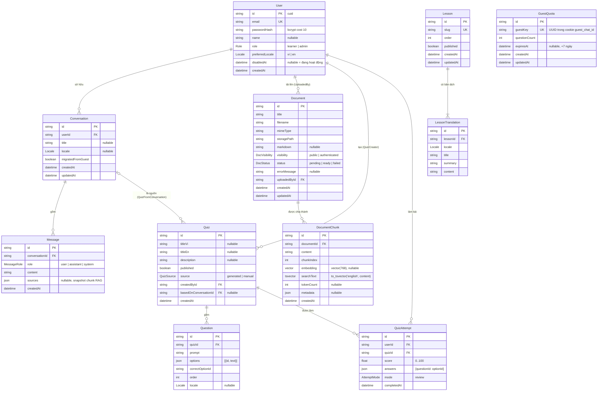

### 4.2 Kiểu liệt kê (enum)

| Enum | Giá trị | Ý nghĩa |
|---|---|---|
| `Role` | `learner`, `admin` | Vai trò người dùng |
| `Locale` | `vi`, `en` | Ngôn ngữ |
| `MessageRole` | `user`, `assistant`, `system` | Vai trò tin nhắn |
| `DocVisibility` | `public`, `authenticated` | `public`: cả khách dùng được; `authenticated`: chỉ người đã đăng nhập |
| `DocStatus` | `pending`, `ready`, `failed` | Trạng thái ingest |
| `QuizSource` | `generated`, `manual` | Nguồn tạo quiz |
| `AttemptMode` | `review` | Chế độ làm bài |

### 4.3 Đặc tả bảng

Ký hiệu: **PK** khóa chính, **FK** khóa ngoại, **UK** duy nhất, **NN** not null. Mọi `id` là `cuid()` (riêng `DocumentChunk.id`
được chèn bằng `randomUUID()` khi ingest).

#### 4.3.1 `User` — người dùng

| Cột | Kiểu | Ràng buộc | Mặc định | Mô tả |
|---|---|---|---|---|
| id | text | PK | cuid() | |
| email | text | UK, NN | | Lưu chữ thường |
| passwordHash | text | NN | | bcrypt |
| name | text | | | Tên hiển thị |
| role | Role | NN | `learner` | |
| preferredLocale | Locale | NN | `vi` | |
| disabledAt | timestamp | | null | Khác null = tài khoản bị khóa |
| createdAt | timestamp | NN | now() | |

#### 4.3.2 `GuestQuota` — hạn mức câu hỏi của khách

| Cột | Kiểu | Ràng buộc | Mặc định | Mô tả |
|---|---|---|---|---|
| id | text | PK | cuid() | |
| guestKey | text | UK, NN | | UUID lưu trong cookie httpOnly `guest_chat_id` (7 ngày) |
| questionCount | int | NN | 0 | Số câu đã hỏi |
| expiresAt | timestamp | | | Thời điểm hết hạn (+7 ngày) |
| createdAt / updatedAt | timestamp | NN | now() | |

Bản ghi bị xóa khi khách đăng nhập và chuyển hội thoại (`clearGuestQuota`).

#### 4.3.3 `Conversation` — hội thoại

| Cột | Kiểu | Ràng buộc | Mặc định | Mô tả |
|---|---|---|---|---|
| id | text | PK | cuid() | |
| userId | text | FK → User.id, NN, `ON DELETE CASCADE` | | Chủ sở hữu |
| title | text | | | 60 ký tự đầu của câu hỏi đầu tiên; mặc định `New chat` |
| locale | Locale | | | |
| migratedFromGuest | boolean | NN | false | Chuyển từ phiên khách |
| createdAt / updatedAt | timestamp | NN | | `updatedAt` cập nhật mỗi lượt hỏi |

Chỉ mục: `(userId, updatedAt)`.

#### 4.3.4 `Message` — tin nhắn

| Cột | Kiểu | Ràng buộc | Mô tả |
|---|---|---|---|
| id | text | PK | |
| conversationId | text | FK → Conversation.id, `ON DELETE CASCADE` | |
| role | MessageRole | NN | |
| content | text | NN | Câu trả lời chứa marker trích dẫn `[n]` |
| sources | jsonb | | Mảng `MessageSource` (xem 4.4). `null` = tin cũ / chuyển từ khách; `[]` = trả lời không dùng tài liệu |
| createdAt | timestamp | NN | |

Chỉ mục: `(conversationId, createdAt)`.

#### 4.3.5 `Document` — tài liệu nguồn của RAG

| Cột | Kiểu | Ràng buộc | Mặc định | Mô tả |
|---|---|---|---|---|
| id | text | PK | | |
| title | text | NN | | |
| filename | text | NN | | Tên file đã làm sạch `[a-zA-Z0-9._-]` |
| mimeType | text | NN | | `application/pdf` hoặc `text/markdown` (dữ liệu seed) |
| storagePath | text | NN | | `UPLOAD_DIR/<timestamp>-<uuid8>-<tên>` hoặc `seed://...` |
| markdown | text | | | Văn bản đã trích và làm sạch |
| visibility | DocVisibility | NN | `public` | |
| status | DocStatus | NN | `pending` | |
| errorMessage | text | | | Lỗi song ngữ, hoặc cảnh báo "bỏ N chunk lỗi" khi `ready` |
| uploadedById | text | FK → User.id | | |
| createdAt / updatedAt | timestamp | NN | | |

Chỉ mục: `(status, visibility)`.

#### 4.3.6 `DocumentChunk` — đoạn tài liệu đã nhúng

| Cột | Kiểu | Ràng buộc | Mô tả |
|---|---|---|---|
| id | text | PK | |
| documentId | text | FK → Document.id, `ON DELETE CASCADE` | |
| content | text | NN | Đoạn ~`CHUNK_SIZE` (800) ký tự, chồng lấp `CHUNK_OVERLAP` (80), cắt theo câu |
| chunkIndex | int | NN | Thứ tự trong tài liệu |
| embedding | `vector(768)` | | Vector BKAI (số chiều phải khớp `EMBED_DIM`) |
| searchText | `tsvector` | | `to_tsvector('english', content)` cho tìm kiếm từ khóa |
| tokenCount | int | | Ước lượng `ceil(len/4)` |
| metadata | jsonb | | Dự phòng |
| createdAt | timestamp | NN | |

Chỉ mục: `(documentId, chunkIndex)`; GIN trên `searchText`.

Lịch sử số chiều vector theo migration: 1536 (`init`) → 384 → 1536 → **768** (`20261010000000_embed_dim_768`).
Đổi số chiều cần migrate rồi Reindex toàn bộ tài liệu.

#### 4.3.7 `Lesson` và `LessonTranslation` — bài học song ngữ

| Bảng | Cột | Kiểu | Ràng buộc | Mô tả |
|---|---|---|---|---|
| Lesson | id | text | PK | |
| | slug | text | UK, regex `^[a-z0-9-]+$` | Đường dẫn bài học |
| | order | int | mặc định 0 | Thứ tự hiển thị |
| | published | boolean | mặc định false | Chỉ bài đã xuất bản hiện cho người học |
| | createdAt / updatedAt | timestamp | | |
| LessonTranslation | id | text | PK | |
| | lessonId | text | FK → Lesson.id, `ON DELETE CASCADE` | |
| | locale | Locale | UK cùng `lessonId` | |
| | title | text | ≤ 200 | |
| | summary | text | ≤ 500 | |
| | content | text | ≤ 50 000 | |

#### 4.3.8 `Quiz`, `Question`, `QuizAttempt` — ôn tập

| Bảng | Cột | Kiểu | Ràng buộc | Mô tả |
|---|---|---|---|---|
| Quiz | id | text | PK | |
| | titleVi, titleEn, description | text | | Do LLM sinh |
| | published | boolean | mặc định false | |
| | source | QuizSource | mặc định `generated` | |
| | createdById | text | FK → User.id, CASCADE | |
| | basedOnConversationId | text | FK → Conversation.id, `ON DELETE SET NULL` | |
| | createdAt | timestamp | | Chỉ mục `(createdById, createdAt)` |
| Question | id | text | PK | |
| | quizId | text | FK → Quiz.id, CASCADE | |
| | prompt | text | | Nội dung câu hỏi |
| | options | jsonb | | `[{ "id": "a", "text": "..." }, ...]` |
| | correctOptionId | text | | Không trả về client trước khi nộp |
| | order | int | | Chỉ mục `(quizId, order)` |
| | locale | Locale | | |
| QuizAttempt | id | text | PK | |
| | userId | text | FK → User.id, CASCADE | |
| | quizId | text | FK → Quiz.id, CASCADE | |
| | score | float | | Phần trăm làm tròn |
| | answers | jsonb | | `{ questionId: optionId }` |
| | mode | AttemptMode | `review` | |
| | completedAt | timestamp | | Chỉ mục `(userId, completedAt)` |

### 4.4 Cấu trúc JSON `Message.sources`

```jsonc
[
  {
    "index": 1,                       // số [n] model trích dẫn
    "chunkId": "…", "documentId": "…", "documentTitle": "Password Storage Cheat Sheet",
    "chunkIndex": 12,
    "content": "…",                   // snapshot nội dung, giữ được khi tài liệu bị reindex/xóa
    "score": 0.71,                    // cosine (method=vector) hoặc ts_rank_cd (method=keyword)
    "method": "vector",               // "vector" | "keyword"
    "rerankScore": 0.93,              // cross-encoder 0..1 (tùy chọn)
    "support": [                      // hậu kiểm trích dẫn (tùy chọn)
      { "claim": "Dùng Argon2id…", "score": 0.88, "evidence": { "start": 120, "end": 210 } }
    ],
    "judge": {                        // LLM-as-judge (tùy chọn)
      "questionRelevance": 92,        // ≥70 sát câu hỏi, 40–69 liên quan một phần, <40 không liên quan
      "answerContribution": 80,
      "reason": "…"
    }
  }
]
```

### 4.5 Truy vấn đặc thù (raw SQL)

- **Chèn chunk** (`ingest.ts`): một `INSERT` nhiều dòng mỗi lô `EMBED_BATCH_SIZE` (32), ghi `embedding = $n::vector` và
  `searchText = to_tsvector('english', content)`.
- **Tìm vector**: khoảng cách cosine `embedding <=> $query::vector` trên chunk của tài liệu `status = 'ready'` và
  `visibility = ANY($visibilities)`, lấy `RAG_CANDIDATES` (20) ứng viên mỗi truy vấn.
- **Tìm từ khóa**: `searchText @@ to_tsquery('english', w1 | w2 | …)`, xếp theo `ts_rank_cd`, lấy một nửa số ứng viên vector.
- **Kiểm tra thực thể**: full-text xem tài liệu có nhắc tới thực thể được hỏi (CVE, tên luật…) hay không.

---

## 5. Thiết kế sơ đồ tuần tự (Sequence diagram)

### 5.1 Đăng ký tài khoản (F01)

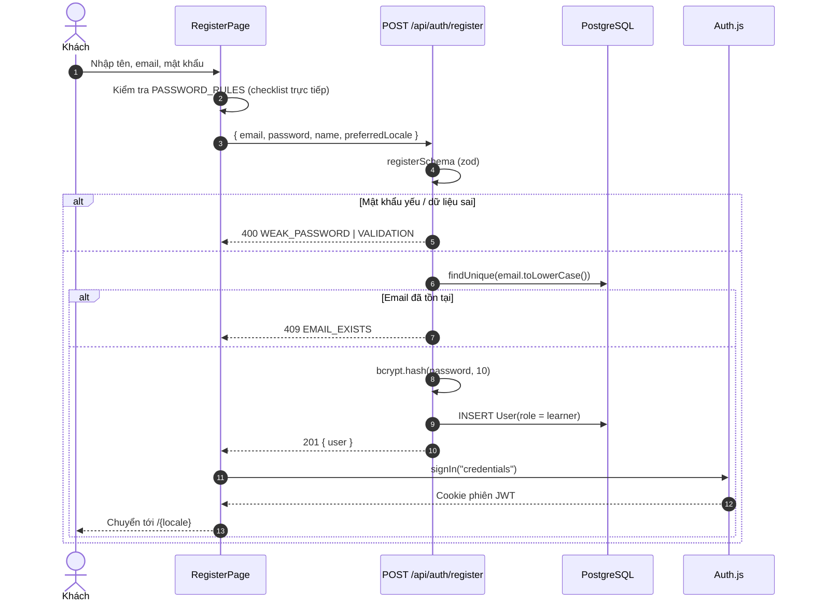

### 5.2 Đăng nhập (F02)

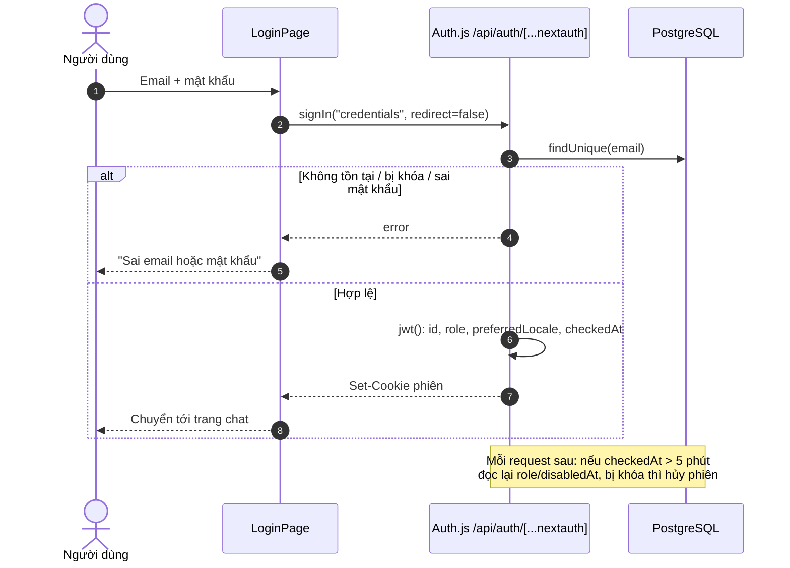

### 5.3 Khách hỏi chatbot (F04, F05)

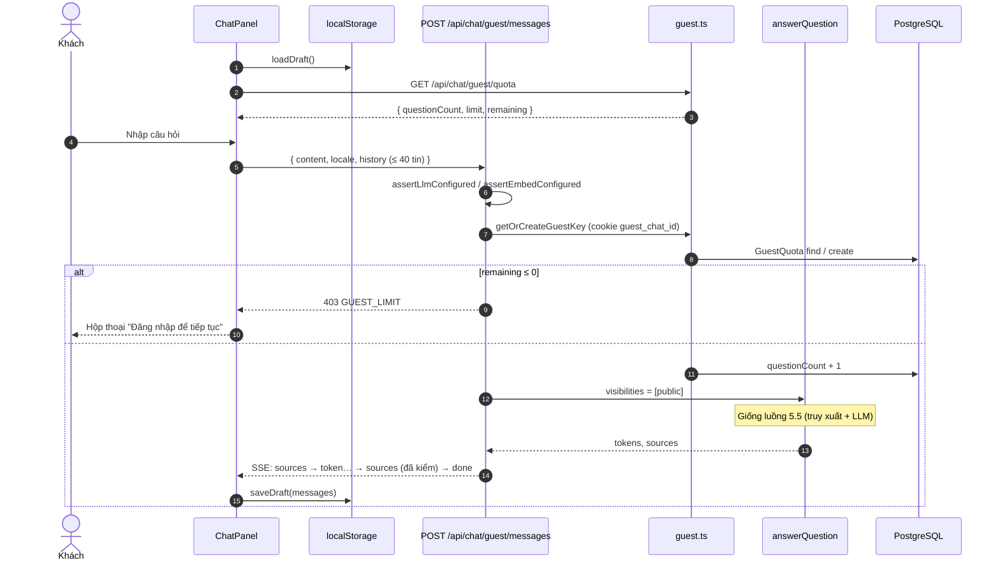

### 5.4 Chuyển hội thoại khách vào tài khoản (F08)

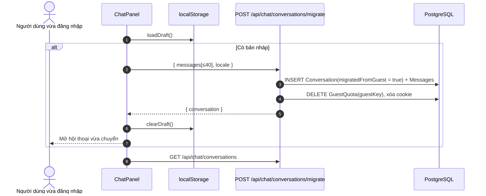

### 5.5 Người dùng hỏi chatbot — luồng RAG đầy đủ (F07, F10–F12, F09)

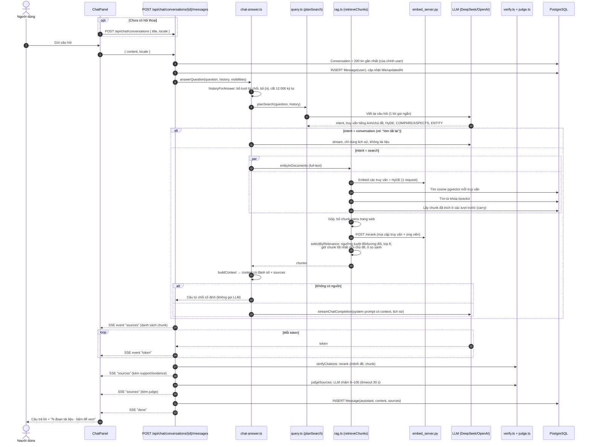

### 5.6 Admin tải PDF và ingest nền (F17, F18)

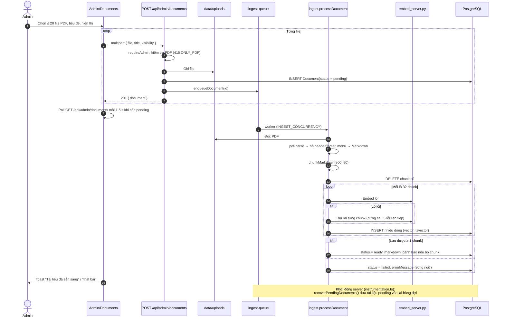

### 5.7 Reindex / xóa tài liệu (F17)

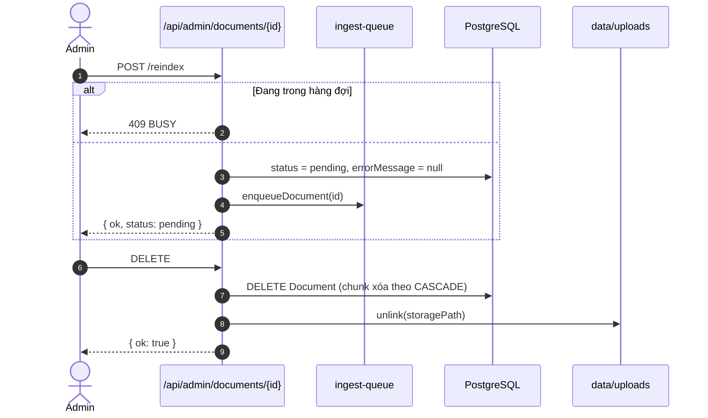

### 5.8 Tạo và làm bộ ôn tập (F14, F15)

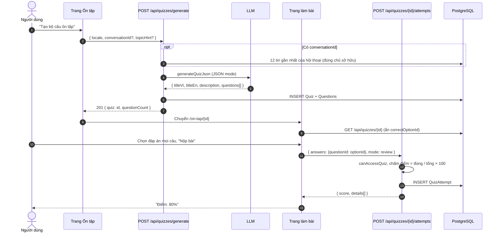

### 5.9 Admin quản lý người dùng (F16)

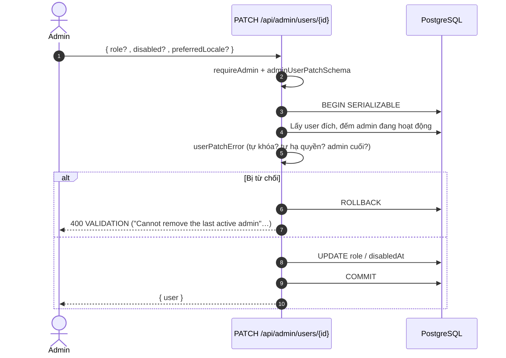

---

## 6. Thiết kế API

### 6.1 Quy ước chung

- Base URL: `http://<host>:3847`. Body JSON (`Content-Type: application/json`) trừ upload (`multipart/form-data`).
- Xác thực: cookie phiên Auth.js (JWT). Cột **Quyền**: `Public`, `Guest` (cookie `guest_chat_id` tự cấp), `User` (đã đăng nhập,
  không bị khóa), `Admin`.
- Định dạng lỗi:

```json
{ "error": "Thông điệp", "code": "MÃ_LỖI", "messageVi": "…", "messageEn": "…" }
```

`messageVi`/`messageEn` chỉ có ở lỗi cấu hình / nhà cung cấp (`AppError`).

| HTTP | `code` | Ý nghĩa |
|---|---|---|
| 400 | `VALIDATION`, `WEAK_PASSWORD` | Dữ liệu không hợp lệ |
| 401 | `UNAUTHORIZED` | Chưa đăng nhập hoặc tài khoản bị khóa |
| 403 | `FORBIDDEN`, `GUEST_LIMIT` | Không đủ quyền; khách hết lượt hỏi |
| 404 | `NOT_FOUND`, `FILE_MISSING` | Không tìm thấy (hoặc không thuộc về người gọi) |
| 409 | `EMAIL_EXISTS`, `EXISTS`, `BUSY` | Trùng email / slug; tài liệu đang xử lý |
| 415 | `ONLY_PDF` | Chỉ nhận PDF |
| 500 | `SERVER` | Lỗi máy chủ |
| 502 | `LLM_API_ERROR`, `EMBED_API_ERROR` | Gọi LLM / embedding thất bại |
| 503 | `LLM_KEY_MISSING`, `EMBED_KEY_MISSING` | Thiếu cấu hình nhà cung cấp |

### 6.2 Danh sách endpoint

| # | Method | Endpoint | Quyền | Chức năng |
|---|---|---|---|---|
| 1 | GET/POST | `/api/auth/[...nextauth]` | Public | Auth.js: đăng nhập, đăng xuất, session, CSRF |
| 2 | POST | `/api/auth/register` | Public | Đăng ký |
| 3 | GET | `/api/auth/me` | User | Thông tin người dùng hiện tại |
| 4 | PATCH | `/api/auth/me` | User | Chưa hỗ trợ (405) |
| 5 | GET | `/api/chat/guest/quota` | Guest | Hạn mức câu hỏi khách |
| 6 | POST | `/api/chat/guest/messages` | Guest | Hỏi chatbot (SSE) |
| 7 | GET | `/api/chat/conversations` | User | Danh sách hội thoại |
| 8 | POST | `/api/chat/conversations` | User | Tạo hội thoại |
| 9 | GET | `/api/chat/conversations/{id}` | User (chủ) | Chi tiết hội thoại + tin nhắn |
| 10 | DELETE | `/api/chat/conversations/{id}` | User (chủ) | Xóa hội thoại |
| 11 | POST | `/api/chat/conversations/{id}/messages` | User (chủ) | Hỏi chatbot (SSE) |
| 12 | POST | `/api/chat/conversations/migrate` | User | Chuyển hội thoại khách |
| 13 | GET | `/api/lessons?locale=` | Public | Danh sách bài học đã xuất bản |
| 14 | GET | `/api/lessons/{slug}?locale=` | Public | Chi tiết bài học |
| 15 | POST | `/api/quizzes/generate` | User | Sinh bộ ôn tập |
| 16 | GET | `/api/quizzes/mine` | User | Bộ ôn tập của tôi |
| 17 | GET | `/api/quizzes/{id}` | User (chủ / published) | Đề bài (ẩn đáp án) |
| 18 | POST | `/api/quizzes/{id}/attempts` | User (chủ / published) | Nộp bài, chấm điểm |
| 19 | GET | `/api/quizzes/attempts/me` | User | 50 lần làm bài gần nhất |
| 20 | GET | `/api/admin/users` | Admin | Danh sách người dùng |
| 21 | PATCH | `/api/admin/users/{id}` | Admin | Đổi vai trò / khóa / ngôn ngữ |
| 22 | DELETE | `/api/admin/users/{id}` | Admin | Khóa tài khoản (soft) |
| 23 | GET | `/api/admin/documents` | Admin | Danh sách tài liệu |
| 24 | POST | `/api/admin/documents` | Admin | Tải PDF lên |
| 25 | GET | `/api/admin/documents/{id}` | Admin | Chi tiết tài liệu |
| 26 | PATCH | `/api/admin/documents/{id}` | Admin | Sửa tiêu đề / hiển thị |
| 27 | DELETE | `/api/admin/documents/{id}` | Admin | Xóa tài liệu + file |
| 28 | GET | `/api/admin/documents/{id}/file` | Admin | Mở file PDF / Markdown gốc |
| 29 | POST | `/api/admin/documents/{id}/reindex` | Admin | Ingest lại |
| 30 | GET | `/api/admin/lessons` | Admin | Mọi bài học kèm bản dịch |
| 31 | POST | `/api/admin/lessons` | Admin | Tạo bài học |
| 32 | GET | `/api/admin/lessons/{id}` | Admin | Chi tiết bài học |
| 33 | PATCH | `/api/admin/lessons/{id}` | Admin | Sửa bài học (thay toàn bộ bản dịch) |
| 34 | DELETE | `/api/admin/lessons/{id}` | Admin | Xóa bài học |

API nội bộ (không qua Next.js) của `scripts/embed_server.py` (cổng 8008):

| Method | Endpoint | Request | Response |
|---|---|---|---|
| POST | `/` | `{ "inputs": "text" \| ["t1","t2"] }` | vector `[...]` hoặc `[[...],[...]]` (đã chuẩn hóa) |
| POST | `/rerank` | `{ "query": "q", "documents": ["d1"] }` hoặc `{ "pairs": [["q","d"]] }` | `[0.93, 0.12, ...]` (sigmoid 0..1) |

### 6.3 Chi tiết endpoint

#### 6.3.1 Xác thực

**POST `/api/auth/register`**

| Trường | Kiểu | Bắt buộc | Ràng buộc |
|---|---|---|---|
| email | string | ✔ | email, ≤ 200 |
| password | string | ✔ | ≤ 128; ≥ 8 ký tự, có hoa, thường, số, ký tự đặc biệt (Unicode) |
| name | string | | 1–80 |
| preferredLocale | `vi` \| `en` | | mặc định `vi` |

```json
// 201
{ "user": { "id": "clx…", "email": "a@b.com", "role": "learner", "preferredLocale": "vi", "name": "An" } }
```
Lỗi: 400 `WEAK_PASSWORD` / `VALIDATION`, 409 `EMAIL_EXISTS`, 500 `SERVER`.

**POST `/api/auth/callback/credentials`** (Auth.js, gọi qua `signIn("credentials")`): `email`, `password` (6–128).
Tài khoản bị khóa hoặc sai mật khẩu → lỗi đăng nhập.

**GET `/api/auth/me`** → `200 { id, email, name, role, preferredLocale }`; 401 nếu chưa đăng nhập.

#### 6.3.2 Chatbot

**GET `/api/chat/guest/quota`** → `200 { "questionCount": 3, "limit": 10, "remaining": 7 }` (tự cấp cookie nếu chưa có).

**POST `/api/chat/guest/messages`** — response `text/event-stream`

| Trường | Kiểu | Bắt buộc | Ràng buộc |
|---|---|---|---|
| content | string | ✔ | 1–4000 |
| locale | `vi` \| `en` | | mặc định `vi` |
| history | `[{role: user\|assistant, content}]` | | ≤ 40 phần tử, mỗi content ≤ 8000 |

Lỗi trước khi stream: 400 `VALIDATION`, 403 `GUEST_LIMIT`, 502/503 lỗi cấu hình nhà cung cấp.

**Định dạng SSE** (cả khách và người dùng):

```text
event: sources
data: {"sources":[{ "index":1, "chunkId":"…", "documentTitle":"…", "content":"…", "score":0.71, "method":"vector", "rerankScore":0.93 }]}

event: token
data: {"token":"Mật khẩu mạnh "}

event: token
data: {"token":"nên dài ít nhất 12 ký tự [1]."}

event: sources
data: {"sources":[{ …, "support":[{"claim":"…","score":0.88,"evidence":{"start":0,"end":96}}] }]}

event: sources
data: {"sources":[{ …, "judge":{"questionRelevance":92,"answerContribution":80,"reason":"…"} }]}

event: done
data: {"ok":true}
```
Lỗi giữa chừng: `event: error` + `data: {"message":"…"}`.

**GET `/api/chat/conversations`**
```json
{ "conversations": [ { "id": "…", "title": "Mật khẩu mạnh…", "locale": "vi", "migratedFromGuest": false,
                       "createdAt": "…", "updatedAt": "…" } ] }
```
Sắp xếp `updatedAt` giảm dần.

**POST `/api/chat/conversations`** — body `{ title?: string ≤120, locale?: vi|en }` → `201 { conversation }`
(title mặc định `New chat`).

**GET `/api/chat/conversations/{id}`** → `200 { conversation: { …, messages: [{ id, role, content, sources, createdAt }] } }`;
404 nếu không thuộc người gọi.

**DELETE `/api/chat/conversations/{id}`** → `200 { ok: true }` (xóa tin nhắn theo CASCADE).

**POST `/api/chat/conversations/{id}/messages`** — body `{ content: 1–4000, locale? }`; response SSE như trên.
Server tự nạp tối đa 200 tin gần nhất làm lịch sử, lưu tin `user` trước khi trả lời và tin `assistant` (kèm `sources` cuối cùng)
sau khi stream xong.

**POST `/api/chat/conversations/migrate`**

| Trường | Kiểu | Bắt buộc | Ràng buộc |
|---|---|---|---|
| messages | `[{role, content}]` | ✔ | 1–40, content ≤ 8000; tin `system` bị bỏ |
| locale | `vi` \| `en` | | |
| title | string | | ≤ 120; mặc định 60 ký tự đầu câu hỏi đầu |

→ `200 { conversation }`, đồng thời xóa `GuestQuota` và cookie khách.

#### 6.3.3 Bài học

**GET `/api/lessons?locale=vi`**
```json
{ "lessons": [ { "id": "…", "slug": "strong-passwords", "order": 1, "title": "…", "summary": "…", "locale": "vi" } ] }
```

**GET `/api/lessons/{slug}?locale=en`**
```json
{ "lesson": { "id": "…", "slug": "…", "order": 1, "title": "…", "summary": "…", "content": "…",
              "locale": "vi", "usedFallback": true } }
```
`usedFallback = true` khi không có bản dịch theo `locale` yêu cầu và trả về bản `vi`. 404 nếu chưa xuất bản.

#### 6.3.4 Ôn tập

**POST `/api/quizzes/generate`** — body `{ locale?, conversationId?: cuid, topicHint?: ≤200 }`
```json
// 201
{ "quiz": { "id": "…", "titleVi": "Ôn tập bảo mật cơ bản", "titleEn": "Basic security review",
            "description": "…", "questionCount": 5 } }
```
Lỗi: 404 hội thoại không thuộc người gọi, 502/503 lỗi LLM.

**GET `/api/quizzes/mine`** → `{ quizzes: [{ id, titleVi, titleEn, description, source, createdAt, questionCount, attemptCount }] }`

**GET `/api/quizzes/{id}`**
```json
{ "quiz": { "id": "…", "titleVi": "…", "titleEn": "…", "description": "…", "source": "generated", "createdAt": "…",
            "questions": [ { "id": "q1", "prompt": "…", "options": [{"id":"a","text":"…"}], "order": 0, "locale": "vi" } ] } }
```
Không trả `correctOptionId`. 403 `FORBIDDEN` nếu không phải người tạo và quiz chưa `published`.

**POST `/api/quizzes/{id}/attempts`** — body `{ "answers": { "q1": "a", "q2": "c" }, "mode": "review" }`
```json
{ "attempt": { "id": "…", "score": 80, "mode": "review", "completedAt": "…",
               "details": [ { "questionId": "q1", "chosen": "a", "correctOptionId": "a", "isCorrect": true } ] } }
```

**GET `/api/quizzes/attempts/me`** → `{ attempts: [{ id, score, answers, mode, completedAt, quiz: { id, titleVi, titleEn } }] }` (≤ 50).

#### 6.3.5 Quản trị — người dùng

**GET `/api/admin/users`** → `{ users: [{ id, email, name, role, preferredLocale, disabledAt, createdAt }] }`

**PATCH `/api/admin/users/{id}`** — body (mọi trường tùy chọn): `{ role?: learner|admin, disabled?: boolean, preferredLocale?: vi|en }`
→ `200 { user }`. 400 khi tự khóa / tự đổi vai trò / bỏ admin hoạt động cuối cùng.

**DELETE `/api/admin/users/{id}`** — tương đương `PATCH { disabled: true }` (khóa mềm, không xóa dữ liệu).

#### 6.3.6 Quản trị — tài liệu

**GET `/api/admin/documents`**
```json
{ "documents": [ { "id": "…", "title": "…", "filename": "x.pdf", "visibility": "public", "status": "ready",
                   "errorMessage": null, "chunkCount": 142, "createdAt": "…" } ] }
```

**POST `/api/admin/documents`** — `multipart/form-data`

| Trường | Kiểu | Bắt buộc | Ghi chú |
|---|---|---|---|
| file | File | ✔ | `application/pdf` hoặc đuôi `.pdf` |
| title | string | ✔ | |
| visibility | `public` \| `authenticated` | | mặc định `public` |

→ `201 { document }` với `status = pending`; ingest chạy nền. Lỗi 400, 415 `ONLY_PDF`, 500.

**GET `/api/admin/documents/{id}`** → `{ document: { …, _count: { chunks } } }`

**PATCH `/api/admin/documents/{id}`** — `{ title?: 1–200, visibility?: public|authenticated }` → `{ document }`

**DELETE `/api/admin/documents/{id}`** → `{ ok: true }` (xóa bản ghi, chunk và file).

**GET `/api/admin/documents/{id}/file`** → nội dung PDF (hoặc Markdown của tài liệu seed) để xem trong tab mới.

**POST `/api/admin/documents/{id}/reindex`** → `{ ok: true, status: "pending" }`; 409 `BUSY` nếu đang trong hàng đợi.

#### 6.3.7 Quản trị — bài học

**POST `/api/admin/lessons`** và **PATCH `/api/admin/lessons/{id}`** — body:
```json
{
  "slug": "strong-passwords",          // ^[a-z0-9-]+$, ≤ 80
  "order": 1,
  "published": true,
  "vi": { "title": "≤200", "summary": "≤500", "content": "≤50000" },
  "en": { "title": "…",    "summary": "…",    "content": "…" }
}
```
POST → `201 { lesson }` (409 `EXISTS` nếu trùng slug); PATCH → `200 { lesson }` (xóa và tạo lại hai bản dịch).
**GET `/api/admin/lessons`** → `{ lessons: [{ …, translations: [...] }] }` sắp theo `order`.
**DELETE `/api/admin/lessons/{id}`** → `{ ok: true }`.

---

## 7. Thiết kế màn hình (Screen Design)

### 7.1 Sơ đồ điều hướng

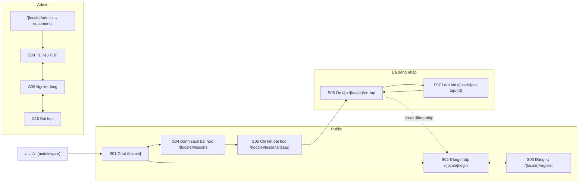

### 7.2 Bố cục chung (AppShell)

Mọi trang dùng `AppShell` (`src/components/layout/app-shell.tsx`):

```text
Desktop (≥ md)                                   Mobile (< md)
┌──────────────┬──────────────────────────────┐  ┌───────────────────────────┐
│ SecLearn     │                     (avatar) │  │ ☰   SecLearn     ☾  (ava) │
│              ├──────────────────────────────┤  ├───────────────────────────┤
│ 💬 Chat      │                              │  │                           │
│ 📖 Bài học   │                              │  │      Nội dung trang       │
│ 🧠 Ôn tập    │        Nội dung trang        │  │                           │
│ 🛡 Quản trị* │                              │  │                           │
│ [AdminNav]** │                              │  └───────────────────────────┘
│              │                              │  ☰ mở sidebar dạng drawer
│ [VI][EN]  ☾  │                              │
│ ┌──────────┐ │                              │
│ │(AV) Tên  │ │                              │
│ │ email    │ │                              │
│ └──────────┘ │                              │
│ hoặc         │                              │
│ [Đăng nhập]  │                              │
│ [Đăng ký]    │                              │
└──────────────┴──────────────────────────────┘
 * chỉ admin   ** chỉ trong khu vực /admin
```

- Menu avatar (`UserMenu`): tên + email, "Hồ sơ", "Quản trị" (admin), "Đăng xuất".
- Nút VI/EN đổi đoạn đầu đường dẫn; ☾ đổi giao diện sáng/tối.

### 7.3 S01 — Chat (trang chủ)

Đường dẫn `/{locale}`. Thành phần: `ChatPanel`, `AnswerMarkdown`, `SourcesPanel`.

```text
┌──────────────┬───────────────────────────────────────────┬────────────────────────────┐
│ [+ Chat mới] │                         [Còn 7/10] (khách) │ Nguồn tham khảo         ✕ │
│ Lịch sử      │                                            │ Model trích dẫn 3/5 đoạn   │
│ ▸ Mật khẩu…  │   ┌──────────────────────────────────┐    │ Hậu kiểm: 4/5 câu được hỗ  │
│ ▸ Phishing 🗑 │   │ Làm sao nhận biết email phishing?│ (U)│ AI đánh giá: 3/5 sát câu   │
│ ▸ 2FA…       │   └──────────────────────────────────┘    │ [Nguồn] [Mức độ liên quan] │
│              │ (AI) Email phishing thường giả mạo          │ ĐƯỢC TRÍCH DẪN (3)         │
│ (chỉ người   │      người gửi [1] và tạo cảm giác          │ ┌────────────────────────┐ │
│  đăng nhập)  │      gấp gáp [2]. …                         │ │[1] Phishing Cheat Sheet│ │
│              │      📄 5 đoạn tài liệu · bấm để xem        │ │ Đoạn #12 · Sát câu hỏi │ │
│              │                                            │ │ Độ liên quan 93%       │ │
│              │                                            │ │ Dùng trong câu trả lời:│ │
│              │                                            │ │ ✔ Nguồn hỗ trợ  "…"    │ │
│              │ ┌────────────────────────────────────┐ ➤  │ └────────────────────────┘ │
│              │ │ Hỏi về mật khẩu, phishing, 2FA...  │    │ KHÔNG ĐƯỢC TRÍCH DẪN (2)   │
│              │ └────────────────────────────────────┘    │ …                          │
└──────────────┴───────────────────────────────────────────┴────────────────────────────┘
```

| Phần tử | Mô tả / hành vi |
|---|---|
| Danh sách hội thoại | Chỉ khi đăng nhập; bấm để mở (`GET /conversations/{id}`), nút xóa (`DELETE`) |
| "Chat mới" | Xóa khung chat; hội thoại được tạo khi gửi câu đầu tiên |
| Huy hiệu hạn mức | Chỉ khách: "Còn {remaining}/{limit}" |
| Trạng thái rỗng | Tiêu đề "SecLearn", mô tả, 3 câu hỏi gợi ý bấm được |
| Bong bóng trả lời | Markdown (GFM). Marker `[n]` thành liên kết mở panel nguồn tại đoạn n; câu không có trích dẫn được đánh dấu ("có thể không dựa trên tài liệu"); rê chuột vào câu có trích dẫn tô vàng câu khớp nhất trong nguồn |
| "N đoạn tài liệu · bấm để xem" | Mở `SourcesPanel` |
| Ô nhập | Textarea, Enter gửi (Shift+Enter xuống dòng); nút gửi bị khóa khi đang stream hoặc rỗng; dòng "Đang trả lời..." |
| SourcesPanel — tab "Nguồn" | Nhóm "Được trích dẫn" / "Không được trích dẫn"; mỗi đoạn: tài liệu, số đoạn, nhãn đánh giá AI, % cross-encoder, nội dung, danh sách mệnh đề dùng đoạn đó kèm ✔/✗ hậu kiểm |
| SourcesPanel — tab "Mức độ liên quan" | Thanh điểm "Đóng góp vào câu trả lời" và "Liên quan câu hỏi" (0–100) cùng lý do do LLM viết |
| Hộp thoại hết lượt | Khi `403 GUEST_LIMIT`: "Đã hết 10 câu hỏi khách", nút Đăng nhập / Đăng ký / Đóng |
| Thông báo lỗi | Theo `code`: thiếu key LLM, lỗi embedding, lỗi API LLM, lỗi chung; tin vừa gửi bị hoàn tác |

### 7.4 S02 — Đăng nhập / S03 — Đăng ký

```text
┌──────────────────────────────┐   ┌──────────────────────────────┐
│ Đăng nhập                    │   │ Đăng ký                      │
│ Email     [_______________]  │   │ Tên       [_______________]  │
│ Mật khẩu  [_______________]  │   │ Email     [_______________]  │
│ (lỗi: sai email/mật khẩu)    │   │ Mật khẩu  [_______________]  │
│ [        Đăng nhập        ]  │   │  ✓ Ít nhất 8 ký tự           │
│ Chưa có tài khoản? Đăng ký   │   │  ○ Có chữ hoa                │
└──────────────────────────────┘   │  ○ Có chữ thường             │
                                   │  ○ Có chữ số                 │
                                   │  ○ Có ký tự đặc biệt         │
                                   │ [         Đăng ký         ]  │
                                   │ Đã có tài khoản? Đăng nhập   │
                                   └──────────────────────────────┘
```

| Màn hình | Kiểm tra | Kết quả |
|---|---|---|
| Đăng nhập | email bắt buộc, mật khẩu ≥ 6 | Thành công → `/{locale}`; thất bại → thông báo lỗi |
| Đăng ký | checklist mật khẩu cập nhật trực tiếp, chặn gửi khi chưa đạt | Thành công → tự đăng nhập → `/{locale}`; lỗi `EMAIL_EXISTS`, `WEAK_PASSWORD` hiển thị riêng |

### 7.5 S04 — Danh sách bài học / S05 — Chi tiết bài học

```text
┌─────────────────────────────────────────┐   ┌─────────────────────────────────────────┐
│ Bài học                                 │   │ Mật khẩu mạnh                           │
│ ┌─────────────────────────────────────┐ │   │ Tóm tắt bài học…                        │
│ │ Mật khẩu mạnh                       │ │   │ ┌─────────────────────────────────────┐ │
│ │ Tóm tắt…                            │ │   │ │ Nội dung bài học                    │ │
│ │ [Ôn tập]                            │ │   │ │ …                                   │ │
│ └─────────────────────────────────────┘ │   │ └─────────────────────────────────────┘ │
│ ┌─────────────────────────────────────┐ │   │ [ Ôn tập ]                              │
│ │ Nhận diện phishing …                │ │   └─────────────────────────────────────────┘
└─────────────────────────────────────────┘
```
Dữ liệu từ `GET /api/lessons?locale=` và `GET /api/lessons/{slug}?locale=`; trạng thái đang tải / rỗng / lỗi.

### 7.6 S06 — Ôn tập / S07 — Làm bài

```text
┌──────────────────────────────────────────────┐   ┌──────────────────────────────────────────┐
│ Ôn tập                [Tạo bộ câu ôn tập]    │   │ ← Ôn tập                                 │
│ ┌──────────────────────────────────────────┐ │   │ Ôn tập bảo mật cơ bản                    │
│ │ Ôn tập bảo mật cơ bản          [Làm bài] │ │   │ ┌──────────────────────────────────────┐ │
│ │ 5 câu · 18/10/2026 10:21                 │ │   │ │ Điểm: 80%                            │ │
│ └──────────────────────────────────────────┘ │   │ └──────────────────────────────────────┘ │
│ Lịch sử làm bài                              │   │ ┌──────────────────────────────────────┐ │
│ ┌──────────────────────────────────────────┐ │   │ │ 1. Mật khẩu mạnh nên có đặc điểm nào?│ │
│ │ Ôn tập bảo mật cơ bản                    │ │   │ │ ( ) Dài, ngẫu nhiên, không tái dùng  │ │
│ │ Điểm: 80% · 18/10/2026 10:30             │ │   │ │ ( ) Chỉ gồm ngày sinh                │ │
│ └──────────────────────────────────────────┘ │   │ │ …                                    │ │
└──────────────────────────────────────────────┘   │ └──────────────────────────────────────┘ │
 Chưa đăng nhập: "Đăng nhập để dùng Ôn tập"         │ [ Nộp bài ]  (khóa tới khi trả lời đủ)   │
 + nút Đăng nhập                                    └──────────────────────────────────────────┘
```

| Phần tử | Hành vi |
|---|---|
| "Tạo bộ câu ôn tập" | `POST /api/quizzes/generate` → chuyển tới S07; hiển thị "Đang tạo câu hỏi..." |
| Danh sách bộ câu | `GET /api/quizzes/mine`; tiêu đề theo ngôn ngữ hiện tại |
| Lịch sử làm bài | `GET /api/quizzes/attempts/me` |
| S07 lựa chọn | Radio mỗi câu; khóa sau khi nộp |
| "Nộp bài" | Chỉ bật khi đã trả lời mọi câu; `POST /attempts`; hiện thẻ "Điểm: X%" |

### 7.7 S08 — Quản trị: Tài liệu PDF

```text
┌──────────────┬────────────────────────────────────────────────────────────────┐
│ …            │ Tài liệu PDF                                                   │
│ ┌──────────┐ │ Ingest dùng EMBED_PROVIDER… sửa .env rồi Reindex.              │
│ │Người dùng│ │ ┌─ Tải PDF lên ──────────────────────────────────────────────┐ │
│ │Tài liệu ●│ │ │ Tiêu đề     [VD: Giới thiệu mật khẩu        ]              │ │
│ │Bài học   │ │ │ Hiển thị    [Công khai ▾]                                  │ │
│ └──────────┘ │ │ File PDF    [Chọn tệp…] (có thể chọn nhiều file)           │ │
│              │ │                                    [ Tải PDF lên ]         │ │
│              │ └────────────────────────────────────────────────────────────┘ │
│              │ Danh sách tài liệu                                 [⟳ Làm mới] │
│              │ ┌────────────────────────────────────────────────────────────┐ │
│              │ │ 🔗 Password Storage Cheat Sheet         ● Sẵn sàng         │ │
│              │ │ password.pdf · Chunks: 142     [Công khai ▾][Reindex][Xóa] │ │
│              │ ├────────────────────────────────────────────────────────────┤ │
│              │ │ 🔗 XSS Prevention                       ◌ Đang xử lý       │ │
│              │ │ Trích xuất → Markdown → chunk → embed…                     │ │
│              │ ├────────────────────────────────────────────────────────────┤ │
│              │ │ 🔗 Scan.pdf                              ✕ Thất bại        │ │
│              │ │ Không trích xuất được chữ từ PDF                           │ │
│              │ └────────────────────────────────────────────────────────────┘ │
└──────────────┴────────────────────────────────────────────────────────────────┘
```

| Phần tử | Hành vi |
|---|---|
| Form tải lên | Lọc chỉ PDF, tối đa 20 file mỗi lần; nhiều file thì tiêu đề lấy theo tên file; tải tuần tự, nút hiển thị "Đang tải {done}/{total}..." |
| Danh sách | Poll mỗi 1,5 s khi có tài liệu `pending`, 12 s khi không; toast khi tài liệu chuyển sang Sẵn sàng / Thất bại |
| Tiêu đề 🔗 | Mở `GET /api/admin/documents/{id}/file` trong tab mới |
| Hiển thị ▾ | `PATCH` đổi `public` / `authenticated` |
| Reindex | `POST /reindex`; 409 nếu đang xử lý |
| Xóa | `DELETE`; toast "Đã xóa tài liệu" |

### 7.8 S09 — Quản trị: Người dùng

```text
┌────────────────────────────────────────────────────────────────┐
│ Người dùng                                                     │
│ ┌────────────────────────────────────────────────────────────┐ │
│ │ admin@seclearn.local                                 (Bạn) │ │
│ │ Vai trò: admin                                             │ │
│ ├────────────────────────────────────────────────────────────┤ │
│ │ an@example.com                [Toggle role] [Đã khóa]      │ │
│ │ Vai trò: learner                                           │ │
│ ├────────────────────────────────────────────────────────────┤ │
│ │ binh@example.com              [Toggle role] [Enable]       │ │
│ │ Vai trò: learner · Đã khóa                                 │ │
│ └────────────────────────────────────────────────────────────┘ │
└────────────────────────────────────────────────────────────────┘
```
Hàng của chính admin chỉ hiện nhãn "Bạn", không có nút. Lỗi từ API (vd. "Cannot remove the last active admin") hiện bằng toast.

### 7.9 S10 — Quản trị: Bài học

```text
┌────────────────────────────────────────────────────────────────┐
│ Bài học                                                        │
│ ┌────────────────────────────────────────────────────────────┐ │
│ │ Slug [strong-passwords]   Thứ tự [1]   ☑ Xuất bản          │ │
│ │ ── Tiếng Việt ───────────────  ── English ───────────────  │ │
│ │ Tiêu đề  [__________]          Title    [__________]       │ │
│ │ Tóm tắt  [__________]          Summary  [__________]       │ │
│ │ Nội dung [          ]          Content  [          ]       │ │
│ │          [__________]                   [__________]       │ │
│ │ [Create / Lưu]  [Hủy sửa]                                  │ │
│ └────────────────────────────────────────────────────────────┘ │
│ ┌────────────────────────────────────────────────────────────┐ │
│ │ 1 · strong-passwords · Mật khẩu mạnh      [Sửa] [Xóa]      │ │
│ └────────────────────────────────────────────────────────────┘ │
└────────────────────────────────────────────────────────────────┘
```
Bắt buộc đủ hai bản dịch VI và EN; slug chỉ gồm `a-z`, `0-9`, `-`. Nút "Sửa" nạp bài vào form, "Lưu" gọi `PATCH`, "Create" gọi `POST`.

### 7.10 Quy ước giao diện

| Hạng mục | Quy ước |
|---|---|
| Màu | Biến CSS `--accent`, `--surface`, `--sidebar`, `--border`, `--text`, `--text-muted`, `--danger`, `--chat-user`; có chế độ sáng/tối |
| Thành phần | `Button` (default, outline, secondary, ghost, danger; size sm/icon), `Card`, `Input`, `Textarea`, `Label`, `Avatar`, `DropdownMenu` |
| Phản hồi | Toast (sonner) cho thao tác admin; chữ đỏ `--danger` cho lỗi form; khung xám nhấp nháy khi đang tải phiên |
| Ngôn ngữ | Toàn bộ chuỗi trong `src/messages/vi.json`, `src/messages/en.json`; lỗi API có cả `messageVi` và `messageEn` |
| Responsive | Sidebar cố định ≥ `md`, drawer trên mobile; nội dung giới hạn `max-w-3xl` / `max-w-4xl` |

---

## 8. Phụ lục: cấu hình môi trường

Định nghĩa trong `src/lib/env.ts` (kiểm tra bằng zod; cảnh báo cấu hình khi khởi động qua `src/instrumentation.ts`).

| Biến | Mặc định | Ý nghĩa |
|---|---|---|
| `DATABASE_URL`, `AUTH_SECRET` | (bắt buộc) | Kết nối CSDL, khóa ký JWT |
| `ADMIN_EMAIL`, `ADMIN_PASSWORD` | (bắt buộc) | Tài khoản admin do seed tạo |
| `LLM_PROVIDER`, `LLM_MODEL` | `deepseek`, `deepseek-flash` | `mock` \| `openai` \| `deepseek` |
| `EMBED_PROVIDER`, `EMBED_MODEL`, `EMBED_DIM` | `openai`, `text-embedding-3-small`, 1536 | Bản đang chạy: `huggingface` + BKAI, 768, `HF_EMBED_URL=http://127.0.0.1:8008` |
| `RERANK_URL` | rỗng | Endpoint `/rerank`; rỗng thì chỉ xếp theo cosine |
| `GUEST_QUESTION_LIMIT` | 10 | Số câu hỏi của khách |
| `RAG_TOP_K`, `RAG_CANDIDATES` | 5, 20 | Số chunk đưa cho LLM, số ứng viên cho reranker |
| `RAG_MIN_RELEVANCE`, `RAG_MIN_RELEVANCE_EN`, `RAG_RELATIVE_MIN`, `RAG_MIN_KEEP` | 0.01, 0.05, 0.1, 2 | Ngưỡng chọn chunk |
| `RAG_TRANSLATE_QUERY`, `RAG_JUDGE` | `on`, `on` | Dịch câu hỏi sang tiếng Anh; LLM-as-judge sau trả lời |
| `CHUNK_SIZE`, `CHUNK_OVERLAP` | 800, 80 | Kích thước chunk |
| `INGEST_CONCURRENCY`, `EMBED_BATCH_SIZE` | 2, 32 | Số tài liệu ingest song song, số chunk mỗi lô |
| `UPLOAD_DIR` | `./data/uploads` | Thư mục lưu PDF |
